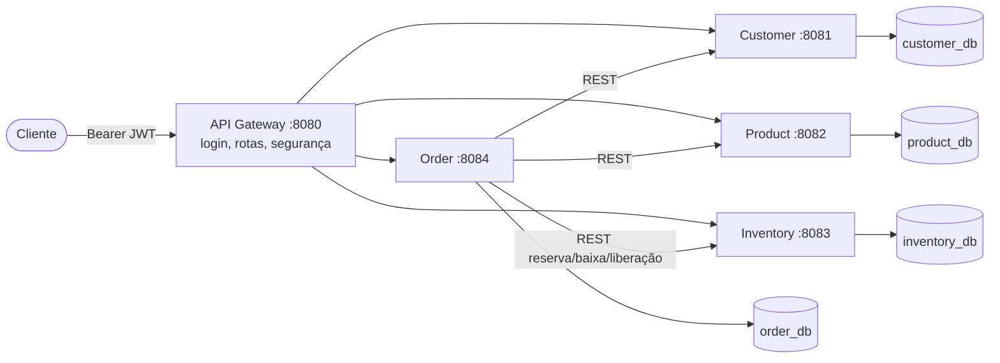

# ecommerce-microservices-java

[](https://github.com/viniciusprogr/ecommerce-microservices-java/actions/workflows/ci.yml)


Sistema de **gerenciamento de pedidos de e-commerce** com arquitetura de **microsserviços** em Java 21 e Spring Boot 3:
clientes, catálogo de produtos, controle de estoque com reservas e pedidos com ciclo de vida completo, todos
atrás de um API Gateway com autenticação JWT.

## Objetivo

Ser um projeto de portfólio **real, funcional e testado**, e também um ambiente de estudos para backend Java.
O código vem acompanhado de documentação que explica **o porquê** de cada decisão e de um
[guia de estudos](docs/study-guide/README.md) com exercícios.

## Tecnologias

| Área | Stack |
|------|-------|
| Linguagem e build | Java 21, Maven 3.9 (Maven Wrapper), multimódulo |
| Framework | Spring Boot 3.4 (Web, Data JPA, Validation, Security, Actuator), Spring Cloud Gateway 2024.0 |
| Persistência | PostgreSQL 16, Hibernate 6, Flyway, H2 (testes) |
| Segurança | Spring Security, OAuth2 Resource Server, JWT HS256, BCrypt |
| Documentação de API | springdoc-openapi (Swagger UI) |
| Testes | JUnit 5, Mockito, AssertJ, MockMvc, WebTestClient, MockRestServiceServer, MockWebServer, Testcontainers |
| Qualidade | Checkstyle, JaCoCo (mínimo de 70% de linhas por módulo) |
| Infraestrutura | Docker (multi-stage), Docker Compose, GitHub Actions |
| Observabilidade | Actuator (health/metrics), logs estruturados (ECS JSON), Correlation ID |

## Arquitetura



| Serviço | Responsabilidade |
|---------|------------------|
| **api-gateway** | Ponto de entrada, `POST /auth/login` (emite JWT), roteamento, bloqueio de rotas internas, Correlation ID |
| **customer-service** | CRUD de clientes, validação de CPF/e-mail, exclusão lógica |
| **product-service** | Categorias e produtos, preço, disponibilidade comercial, filtros |
| **inventory-service** | Estoque físico/reservado/disponível, reserva idempotente (tudo ou nada), baixa e liberação, lock pessimista |
| **order-service** | Orquestra a criação do pedido (saga com compensação), máquina de estados, eventos de domínio |
| **common** | Biblioteca técnica: erros padronizados, validação de JWT, Correlation ID (sem domínio) |

Fluxo de criação de pedido: validar cliente → buscar produtos (preço) → reservar estoque → gravar pedido
(e, se a gravação falhar, liberar a reserva). Detalhes em [docs/architecture](docs/architecture/overview.md):

- [Visão geral e decisões](docs/architecture/overview.md) · [Comunicação](docs/architecture/communication.md) · [Fluxo de pedidos](docs/architecture/order-flow.md)
- ADRs: [0001 monorepo](docs/architecture/adr/0001-monorepo-maven-multimodule.md) · [0002 banco por serviço](docs/architecture/adr/0002-database-per-service.md) · [0003 common](docs/architecture/adr/0003-shared-technical-library.md) · [0004 orquestração](docs/architecture/adr/0004-synchronous-rest-orchestration.md) · [0005 JWT](docs/architecture/adr/0005-jwt-security.md) · [0006 camadas](docs/architecture/adr/0006-layered-architecture.md) · [0007 testes](docs/architecture/adr/0007-testing-strategy.md) · [0008 Dockerfile](docs/architecture/adr/0008-single-parameterized-dockerfile.md)

## Estrutura de pastas

```
ecommerce-microservices/
├── api-gateway/            # Spring Cloud Gateway (WebFlux) + emissão de JWT
├── common/                 # biblioteca técnica compartilhada (auto-configuração)
├── customer-service/       # cada serviço: controller, service, repository, entity, dto, mapper, exception, config
├── product-service/
├── inventory-service/
├── order-service/          # + client/ (RestClient) e event/ (eventos de domínio)
├── infrastructure/
│   ├── docker/             # Dockerfile parametrizado (multi-stage)
│   ├── database/init/      # cria um banco por serviço
│   └── scripts/            # smoke test ponta a ponta
├── config/checkstyle/      # regras de qualidade
├── docs/                   # architecture, api, database, development, study-guide
├── .github/workflows/      # CI
├── docker-compose.yml
├── .env.example
└── pom.xml                 # POM pai (multimódulo)
```

## Pré-requisitos

- **Docker** e Docker Compose v2 (para rodar tudo e para os testes `*IT`).
- **JDK 21** (apenas para compilar ou rodar fora do Docker). O Maven não precisa ser instalado: use `./mvnw`.

## Como executar com Docker (um comando)

```bash
cp .env.example .env        # troque as senhas e o JWT_SECRET (openssl rand -base64 48)
docker compose up --build
```

Quando todos os containers estiverem `healthy` (`docker compose ps`), o gateway responde em `http://localhost:8080`.
Para validar o fluxo completo automaticamente:

```bash
./infrastructure/scripts/smoke-test.sh
```

## Como executar localmente (sem Docker para os serviços)

```bash
docker compose up -d postgres
export DB_USERNAME=ecommerce DB_PASSWORD=<senha> JWT_SECRET=<segredo>
./mvnw -pl customer-service -am spring-boot:run
```

Para o gateway, defina também `GATEWAY_ADMIN_PASSWORD` e `GATEWAY_USER_PASSWORD`. Mais detalhes em
[docs/development/running-locally.md](docs/development/running-locally.md).

## Como executar os testes

```bash
./mvnw verify               # Checkstyle + unitários + integração (H2) + *IT com PostgreSQL (Testcontainers, exige Docker) + cobertura
./mvnw verify -DskipITs     # tudo, exceto os testes que precisam de Docker
./mvnw -pl order-service -am test -Dtest=OrderServiceTest
```

| Módulo | Testes (`*Test`) | `*IT` (PostgreSQL) |
|--------|------------------|--------------------|
| common | 22 | — |
| customer-service | 34 | 2 |
| product-service | 28 | 1 |
| inventory-service | 32 | 1 (concorrência) |
| order-service | 37 | 1 |
| api-gateway | 9 | — |

Relatórios: `<modulo>/target/surefire-reports` e cobertura em `<modulo>/target/site/jacoco/index.html`.
Estratégia em [ADR-0007](docs/architecture/adr/0007-testing-strategy.md).

## Swagger

| Serviço | URL |
|---------|-----|
| Customer | http://localhost:8081/swagger-ui.html |
| Product | http://localhost:8082/swagger-ui.html |
| Inventory | http://localhost:8083/swagger-ui.html |
| Order | http://localhost:8084/swagger-ui.html |

Use **Authorize** com o token de `POST http://localhost:8080/auth/login`.

## Variáveis de ambiente

| Variável | Usada por | Obrigatória | Descrição |
|----------|-----------|-------------|-----------|
| `POSTGRES_USER` / `POSTGRES_PASSWORD` | postgres, serviços | sim | Credenciais do banco (os serviços recebem como `DB_USERNAME`/`DB_PASSWORD`) |
| `POSTGRES_PORT` | compose | não (5432) | Porta exposta no host |
| `JWT_SECRET` | gateway, serviços | sim | Segredo HMAC com no mínimo 32 caracteres, igual em todos |
| `JWT_ISSUER` | gateway, serviços | não | Emissor do token (`ecommerce-api-gateway`) |
| `JWT_EXPIRATION` | gateway | não (60m) | Validade do token |
| `GATEWAY_ADMIN_USERNAME` / `GATEWAY_ADMIN_PASSWORD` | gateway | senha: sim | Usuário com roles ADMIN e USER |
| `GATEWAY_USER_USERNAME` / `GATEWAY_USER_PASSWORD` | gateway | senha: sim | Usuário com role USER |
| `DB_URL` | serviços | não | JDBC URL (padrão `localhost:5432/<servico>_db`) |
| `CUSTOMER_SERVICE_URL`, `PRODUCT_SERVICE_URL`, `INVENTORY_SERVICE_URL`, `ORDER_SERVICE_URL` | gateway, order | não | Endereços dos serviços |
| `SERVICES_CONNECT_TIMEOUT` / `SERVICES_READ_TIMEOUT` | order | não (2s/5s) | Timeouts das chamadas REST |
| `LOGGING_STRUCTURED_FORMAT_CONSOLE` | todos | não | `ecs` para logs em JSON (ligado no compose) |

Nenhuma credencial real é versionada: o `.env` está no `.gitignore` e o `.env.example` só tem valores de exemplo.

## Exemplos de requisições

```bash
GW=http://localhost:8080
ADMIN=$(curl -s $GW/auth/login -H 'Content-Type: application/json' \
  -d '{"username":"admin","password":"<GATEWAY_ADMIN_PASSWORD>"}' | jq -r .accessToken)

# 1. Catálogo e estoque (ADMIN)
curl -s $GW/api/categories -H "Authorization: Bearer $ADMIN" -H 'Content-Type: application/json' \
  -d '{"name":"Eletronicos"}'
curl -s $GW/api/products -H "Authorization: Bearer $ADMIN" -H 'Content-Type: application/json' \
  -d '{"sku":"MOUSE-001","name":"Mouse sem fio","price":99.90,"categoryId":1}'
curl -s $GW/api/inventory -H "Authorization: Bearer $ADMIN" -H 'Content-Type: application/json' \
  -d '{"productId":1,"quantity":10}'

# 2. Cliente
curl -s $GW/api/customers -H "Authorization: Bearer $ADMIN" -H 'Content-Type: application/json' \
  -d '{"firstName":"Maria","lastName":"Silva","email":"maria@email.com","document":"529.982.247-25"}'

# 3. Pedido: valida cliente e produto, reserva estoque e calcula o total
curl -s $GW/api/orders -H "Authorization: Bearer $ADMIN" -H 'Content-Type: application/json' \
  -d '{"customerId":1,"items":[{"productId":1,"quantity":2}]}'

# 4. Estoque reservado: available = 8
curl -s $GW/api/inventory/1 -H "Authorization: Bearer $ADMIN"

# 5. Enviar o pedido: baixa definitiva do estoque
curl -s -X PATCH $GW/api/orders/1/status -H "Authorization: Bearer $ADMIN" -H 'Content-Type: application/json' \
  -d '{"status":"SHIPPED"}'
```

## Endpoints

| Método | Caminho | Role |
|--------|---------|------|
| POST | `/auth/login` | público |
| GET/POST | `/api/customers` · GET/PUT `/api/customers/{id}` | USER |
| DELETE | `/api/customers/{id}` · PATCH `/api/customers/{id}/activate` | ADMIN |
| GET | `/api/categories`, `/api/categories/{id}`, `/api/products`, `/api/products/{id}` | USER |
| POST/PUT/DELETE | `/api/categories/**`, `/api/products/**` · PATCH `/api/products/{id}/activate` | ADMIN |
| GET | `/api/inventory`, `/api/inventory/{productId}`, `/api/inventory/{productId}/availability` | USER |
| POST/PUT | `/api/inventory`, `/api/inventory/{productId}` | ADMIN |
| POST | `/api/inventory/reservations/**` | interno (403 no gateway) |
| GET/POST | `/api/orders`, GET `/api/orders/{id}` | USER |
| PATCH | `/api/orders/{id}/status` | ADMIN |
| GET | `/actuator/health` (todos os serviços) | público |

Exemplos de requisições e respostas, além dos códigos de erro, em [docs/api](docs/api/README.md).
Modelagem dos bancos em [docs/database](docs/database/model.md).

## Segurança

- O JWT é emitido pelo gateway e **validado em todos os serviços** (defesa em profundidade). Roles: `ADMIN`, `USER`.
- As senhas viram hash BCrypt na inicialização. Os segredos vêm só de variáveis de ambiente, e a aplicação não sobe sem eles.
- Erros 401/403 e de login são genéricos. Stack traces e SQL nunca chegam ao cliente.
- As rotas internas (reservas) são bloqueadas no gateway. Os containers rodam como usuário sem privilégios.
- Decisões e limitações conhecidas: [ADR-0005](docs/architecture/adr/0005-jwt-security.md).

## CI/CD

O [GitHub Actions](.github/workflows/ci.yml) roda em pushes e Pull Requests para `main` e `develop`:

1. Checkstyle.
2. `./mvnw verify`: build, testes unitários, testes de integração (H2), `*IT` com PostgreSQL (Testcontainers) e cobertura mínima.
3. Sobe o `docker compose` completo e executa o smoke test ponta a ponta pelo gateway.

## Git

Fluxo `main` ← `develop` ← `feature/*`, Conventional Commits e tag de release. Veja
[docs/development/git-workflow.md](docs/development/git-workflow.md).

## Estudos

[Guia de estudos](docs/study-guide/README.md): Java, Spring Boot, microsserviços, testes, Mockito, Docker e
[21 desafios](docs/study-guide/09-exercises-and-challenges.md) para evoluir o projeto.
