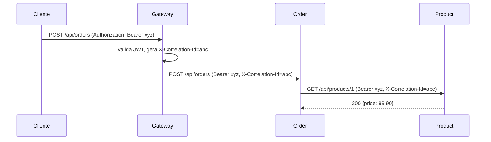

# Comunicação entre serviços

## Visão geral

| Origem | Destino | Operação | Quando |
|--------|---------|----------|--------|
| Cliente | API Gateway | qualquer `/api/**` e `/auth/login` | sempre |
| API Gateway | serviços | proxy HTTP (mesmo path) | após validar o JWT |
| Order | Customer | `GET /api/customers/{id}` | criação do pedido |
| Order | Product | `GET /api/products/{id}` | criação do pedido (para cada item) |
| Order | Inventory | `POST /api/inventory/reservations` | criação do pedido |
| Order | Inventory | `POST /api/inventory/reservations/{ref}/commit` | pedido `SHIPPED` (baixa definitiva) |
| Order | Inventory | `POST /api/inventory/reservations/{ref}/release` | pedido `CANCELLED` ou compensação |

## Como as chamadas são feitas

O `order-service` usa o **`RestClient`** (API síncrona e fluente do Spring 6.1, sucessora do `RestTemplate`).
Cada serviço remoto tem uma classe cliente (`CustomerClient`, `ProductClient`, `InventoryClient`) que:

1. Encapsula a URL e o formato do outro serviço: o resto do código não conhece HTTP.
2. Traduz erros HTTP em exceções do domínio de pedidos:
   - `404` do Customer/Product → `422 Unprocessable Content` (o pedido referencia algo que não existe);
   - `409` do Inventory → `409 Conflict` (estoque insuficiente);
   - timeout, conexão recusada ou `5xx` → `503 Service Unavailable` (`RemoteServiceException`).
3. Usa *timeouts* explícitos (conexão e leitura), para que um serviço lento não trave o Order Service.

Dois interceptors do módulo `common` são aplicados a todos os clientes:

- `BearerTokenPropagationInterceptor`: reenvia o JWT do usuário, pois todos os serviços validam o token.
- `CorrelationIdPropagationInterceptor`: reenvia o `X-Correlation-Id`, para rastrear a requisição nos logs.

## Rotas internas

`/api/inventory/reservations/**` é uma API **interna**: só o Order Service deve chamá-la. O gateway
**nega** essa rota (`403`) para clientes externos. Dentro da rede Docker, o Order Service acessa o Inventory
diretamente (`http://inventory-service:8083`).

> Limitação conhecida (proposital, para manter o projeto simples): o Inventory confia em qualquer token válido
> nessa rota. A evolução natural é o Order Service usar um token próprio (*OAuth2 client credentials*) com uma
> role `SERVICE`. Isso está nos [desafios do guia de estudos](../study-guide/09-exercises-and-challenges.md).

## Preparação para comunicação assíncrona

O Order Service publica eventos de domínio (`OrderEvent`: criado e status alterado) através da interface
`OrderEventPublisher`. A implementação atual (`LoggingOrderEventPublisher`) apenas registra o evento em log
estruturado.

Para migrar para RabbitMQ ou Kafka basta:

1. Adicionar `spring-boot-starter-amqp` (ou `spring-kafka`).
2. Criar `RabbitOrderEventPublisher implements OrderEventPublisher` usando `RabbitTemplate`.
3. Ativá-la por *profile* ou propriedade (`@ConditionalOnProperty`).

Nenhuma regra de negócio muda, pois o `OrderService` depende da **abstração**, não do mecanismo
(Dependency Inversion Principle, o "D" do SOLID).

Candidatos naturais para eventos assíncronos:

- `OrderShipped` → Inventory faz a baixa (hoje é síncrono).
- `OrderCancelled` → Inventory libera a reserva.
- `OrderCreated` → serviço de notificação envia e-mail (serviço novo).
