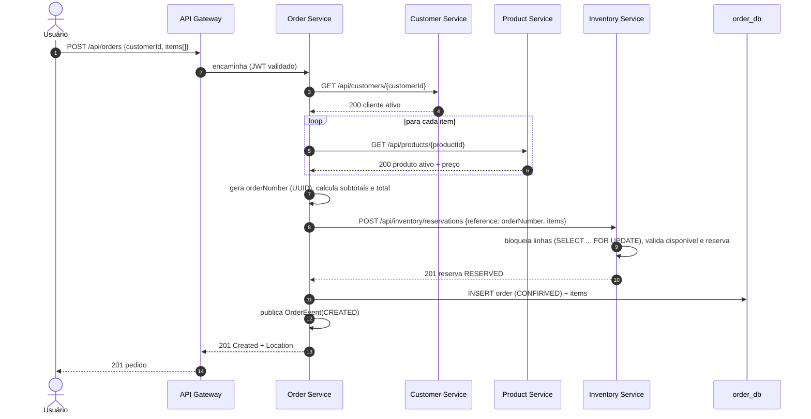
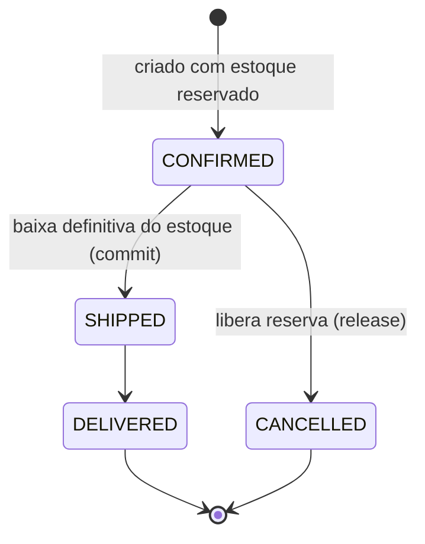

# Fluxo de criação e ciclo de vida de pedidos

## Criação de pedido (caminho feliz)



## Cenários de erro

| Situação | Onde é detectada | Resposta | Efeito colateral |
|----------|------------------|----------|------------------|
| Corpo inválido (sem itens, quantidade <= 0) | Bean Validation | 400 | nenhum |
| Produto repetido na lista | `OrderService` | 422 | nenhum |
| Cliente inexistente ou inativo | `CustomerClient` / `OrderService` | 422 | nenhum |
| Produto inexistente ou inativo | `ProductClient` / `OrderService` | 422 | nenhum |
| Estoque insuficiente | Inventory (409) | 409 | nenhum (a reserva é tudo ou nada) |
| Serviço remoto fora do ar / timeout | clientes HTTP | 503 | nenhum |
| Falha ao gravar o pedido **após** reservar | `OrderService` | 500 | **compensação**: libera a reserva |

### Por que não usar uma única transação?

Cada serviço tem seu próprio banco, então não existe transação ACID que abranja Order e Inventory.
Usamos o padrão **Saga (orquestrada)** em sua forma mais simples: o Order Service coordena os passos e, se um
passo posterior falhar, executa a **ação compensatória** do passo anterior (liberar a reserva).

Duas decisões tornam isso seguro:

1. **Idempotência da reserva**: a reserva é identificada pelo `orderNumber`. Se o Order Service repetir a
   chamada (retry), o Inventory devolve a reserva existente em vez de reservar de novo.
2. **Chamadas remotas fora de `@Transactional`**: o `OrderService` não mantém uma transação de banco aberta
   enquanto espera respostas HTTP, evitando segurar conexões do pool por tempo indeterminado.

## Máquina de estados do pedido



As transições permitidas ficam no próprio enum `OrderStatus` (`canTransitionTo`). Assim a regra mora no
domínio e é testada de forma unitária, sem depender de banco ou HTTP. Uma transição inválida
(ex.: `DELIVERED → CANCELLED`) retorna `409 Conflict`.

Efeitos colaterais de cada transição:

| Transição | Chamada ao Inventory | Efeito no estoque |
|-----------|----------------------|-------------------|
| `CONFIRMED → SHIPPED` | `POST /reservations/{ref}/commit` | `onHand -= q`, `reserved -= q` |
| `CONFIRMED → CANCELLED` | `POST /reservations/{ref}/release` | `reserved -= q` |
| `SHIPPED → DELIVERED` | nenhuma | nenhum |

## Estoque: físico, reservado e disponível

```
disponível = quantidadeEmEstoque (onHand) - quantidadeReservada (reserved)
```

- **Reservar** não tira o produto da prateleira: só impede que outro pedido o use.
- **Commit (baixa)** acontece no envio: o item sai fisicamente.
- **Release** devolve a quantidade reservada para o disponível.
