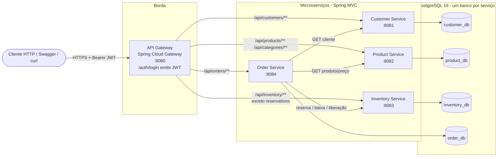

# Visão geral da arquitetura

## 1. Contexto

Sistema de gerenciamento de pedidos de um e-commerce. O objetivo é **didático e profissional**: ele mostra,
com código real e testado, como separar um domínio em microsserviços, como esses serviços se comunicam e como
garantir qualidade (testes, CI, observabilidade e segurança).

## 2. Requisitos

| Requisito | Onde é atendido |
|-----------|-----------------|
| Cadastro e gerenciamento de clientes | `customer-service` |
| Cadastro e gerenciamento de produtos e categorias, preço e disponibilidade comercial (ativo/inativo) | `product-service` |
| Controle de estoque, disponibilidade, reserva e baixa | `inventory-service` |
| Criação, consulta e atualização de status de pedidos | `order-service` |
| Ponto único de entrada, roteamento e segurança | `api-gateway` |
| Comunicação entre serviços | REST síncrono (RestClient), preparado para mensageria |

Requisitos não funcionais:

- **Independência**: cada serviço tem seu próprio banco, build e imagem Docker.
- **Segurança**: JWT emitido pelo gateway e validado em todos os serviços.
- **Observabilidade**: Actuator (health/metrics), logs estruturados (JSON/ECS) e Correlation ID.
- **Qualidade**: testes unitários, de integração (H2 e PostgreSQL real via Testcontainers), Checkstyle e JaCoCo no CI.

## 3. Diagrama dos microsserviços



## 4. Responsabilidades (Bounded Contexts)

| Serviço | Contexto | Agregados / entidades | Dono de |
|---------|----------|-----------------------|---------|
| customer-service | Clientes | `Customer` | dados cadastrais, e-mail e CPF únicos, ativo/inativo |
| product-service | Catálogo | `Category`, `Product` | SKU, preço vigente, categoria, ativo/inativo |
| inventory-service | Estoque | `InventoryItem`, `Reservation` (+ `ReservationLine`) | quantidade física, reservada e disponível |
| order-service | Pedidos | `Order` (+ `OrderItem`) | itens, **cópia do preço no momento da compra**, status |
| api-gateway | Borda | (sem banco) | roteamento, autenticação, emissão de token |

Repare que o `order-service` guarda `productName` e `unitPrice` no `OrderItem`. Isso não é duplicação acidental:
o preço de um pedido **não pode mudar** se o catálogo mudar depois. Esse é um exemplo clássico de como cada
contexto modela o "mesmo" conceito de forma diferente (DDD).

## 5. Estrutura de pastas

```
ecommerce-microservices/
├── pom.xml                      # POM pai (agregador multimódulo)
├── mvnw / mvnw.cmd / .mvn/      # Maven Wrapper: ninguém precisa instalar Maven
├── config/checkstyle/           # regras de qualidade de código
├── common/                      # biblioteca técnica (erros, JWT, correlation id) - sem domínio
├── customer-service/
├── product-service/
├── inventory-service/
├── order-service/
├── api-gateway/
├── infrastructure/
│   ├── docker/                  # Dockerfile parametrizado dos serviços
│   ├── database/init/           # script que cria um banco por serviço
│   └── scripts/                 # smoke test ponta a ponta
├── docs/                        # arquitetura, API, banco, desenvolvimento, guia de estudos
├── .github/workflows/ci.yml     # pipeline CI
├── docker-compose.yml
└── .env.example
```

Cada serviço segue a mesma organização em camadas:

```
<service>/src/main/java/com/ecommerce/<contexto>/
├── controller/   # HTTP: recebe DTOs, valida, delega ao service
├── service/      # regras de negócio e transações
├── repository/   # Spring Data JPA
├── entity/       # entidades JPA (com comportamento, não apenas getters/setters)
├── dto/          # records de entrada e saída
├── mapper/       # conversão entidade <-> DTO
├── exception/    # exceções do domínio
├── client/       # (order-service) clientes HTTP de outros serviços
├── event/        # (order-service) eventos de domínio
└── config/       # segurança, OpenAPI, clientes HTTP
```

**Adaptação em relação à estrutura sugerida:** foi adicionado o módulo `common` e a pasta `config/`.
O `common` evita copiar e colar, em quatro serviços, ~400 linhas de código técnico idêntico
(tratamento de erros, validação de JWT). Ele **não** contém entidades nem regras de negócio, então
não cria acoplamento de domínio. Veja a [ADR-0003](adr/0003-shared-technical-library.md).

## 6. Decisões arquiteturais (ADRs)

| # | Decisão |
|---|---------|
| [0001](adr/0001-monorepo-maven-multimodule.md) | Monorepo com Maven multimódulo |
| [0002](adr/0002-database-per-service.md) | Um banco por serviço, Flyway e Testcontainers |
| [0003](adr/0003-shared-technical-library.md) | Biblioteca técnica compartilhada (`common`) |
| [0004](adr/0004-synchronous-rest-orchestration.md) | Orquestração REST síncrona com compensação |
| [0005](adr/0005-jwt-security.md) | JWT HS256 emitido pelo gateway e validado em todos os serviços |
| [0006](adr/0006-layered-architecture.md) | Arquitetura em camadas, sem Lombok e sem MapStruct |
| [0007](adr/0007-testing-strategy.md) | Estratégia de testes (pirâmide) |
| [0008](adr/0008-single-parameterized-dockerfile.md) | Um Dockerfile parametrizado para todos os serviços |

Leia também: [comunicação entre serviços](communication.md) e [fluxo de criação de pedidos](order-flow.md).

## 7. Stack

| Camada | Tecnologia | Versão |
|--------|------------|--------|
| Linguagem | Java (Eclipse Temurin) | 21 LTS |
| Framework | Spring Boot | 3.4.1 |
| Gateway | Spring Cloud Gateway (Spring Cloud 2024.0.0) | 4.2 |
| Persistência | Spring Data JPA + Hibernate | 6.6 |
| Migrations | Flyway | 10 |
| Banco | PostgreSQL / H2 (testes) | 16 / 2.3 |
| Segurança | Spring Security OAuth2 Resource Server + Nimbus JOSE | 6.4 |
| Documentação de API | springdoc-openapi (Swagger UI) | 2.7.0 |
| Testes | JUnit 5, Mockito, AssertJ, MockMvc, Testcontainers, MockRestServiceServer, MockWebServer | - |
| Qualidade | Checkstyle, JaCoCo (mínimo 70% de linhas por módulo) | - |
| Build | Maven Wrapper | 3.9.9 |
| Infra | Docker, Docker Compose, GitHub Actions | - |
