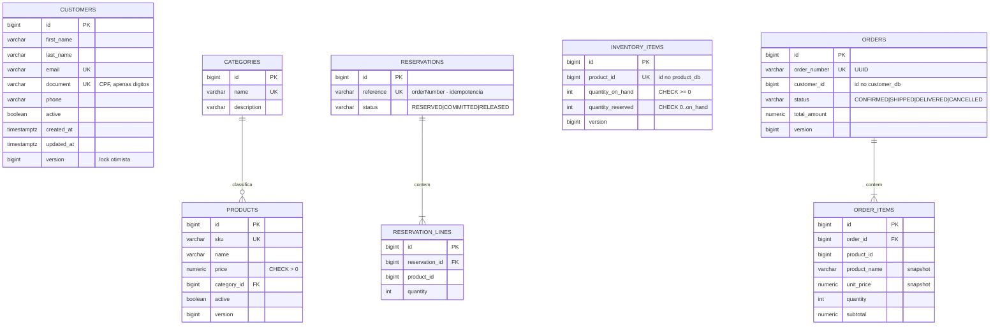

# Modelagem dos bancos de dados

Cada serviço é dono do seu banco (ADR-0002). **Não existem chaves estrangeiras entre bancos**: as referências
entre contextos (`customer_id`, `product_id`) são apenas números, validados via API.



## Por banco

| Banco | Tabelas | Migration |
|-------|---------|-----------|
| `customer_db` | `customers` | [`V1__create_customers_table.sql`](../../customer-service/src/main/resources/db/migration/V1__create_customers_table.sql) |
| `product_db` | `categories`, `products` | [`V1__create_catalog_tables.sql`](../../product-service/src/main/resources/db/migration/V1__create_catalog_tables.sql) |
| `inventory_db` | `inventory_items`, `reservations`, `reservation_lines` | [`V1__create_inventory_tables.sql`](../../inventory-service/src/main/resources/db/migration/V1__create_inventory_tables.sql) |
| `order_db` | `orders`, `order_items` | [`V1__create_orders_tables.sql`](../../order-service/src/main/resources/db/migration/V1__create_orders_tables.sql) |

Os bancos são criados pelo script [`01-create-databases.sh`](../../infrastructure/database/init/01-create-databases.sh),
na primeira subida do container PostgreSQL. As tabelas são criadas por cada serviço via **Flyway** ao iniciar.

## Decisões de modelagem

- **Chave primária `BIGINT GENERATED BY DEFAULT AS IDENTITY`**: padrão SQL suportado por PostgreSQL e H2.
  No JPA: `@GeneratedValue(strategy = IDENTITY)`.
- **Dinheiro em `NUMERIC(19,2)`** ↔ `BigDecimal`. Nunca `double` ou `float`.
- **Datas em `TIMESTAMP WITH TIME ZONE`** ↔ `Instant`, sempre em UTC.
- **Enums como `VARCHAR` + `CHECK`**: legível no banco, e a constraint impede valores inválidos mesmo em
  inserts manuais. No JPA: `@Enumerated(STRING)` + `@JdbcTypeCode(VARCHAR)`.
- **Coluna `version`** (`@Version`): lock otimista. Se duas requisições alteram o mesmo registro ao mesmo
  tempo, a segunda recebe `409` em vez de sobrescrever silenciosamente.
- **Constraints no banco reforçam as regras do domínio** (`quantity_reserved <= quantity_on_hand`,
  `price > 0`). O domínio é a primeira barreira e o banco é a última.
- **Snapshot no pedido** (`product_name`, `unit_price`): o preço de um pedido não muda quando o catálogo muda.
- **Exclusão lógica** (`active = false`) para clientes e produtos: pedidos antigos continuam fazendo sentido.

## Como evoluir o esquema

1. Nunca edite uma migration já aplicada: o Flyway valida o checksum e recusa a inicialização.
2. Crie um novo arquivo: `V2__add_customer_birth_date.sql`.
3. Atualize a entidade JPA. O `ddl-auto: validate` falha se entidade e tabela divergirem.
4. Rode `./mvnw verify` (H2) e confira os `*IT` (PostgreSQL) no CI.

## Acessando o banco local

```bash
docker compose exec postgres psql -U ecommerce -d order_db -c "select order_number, status, total_amount from orders;"
```
