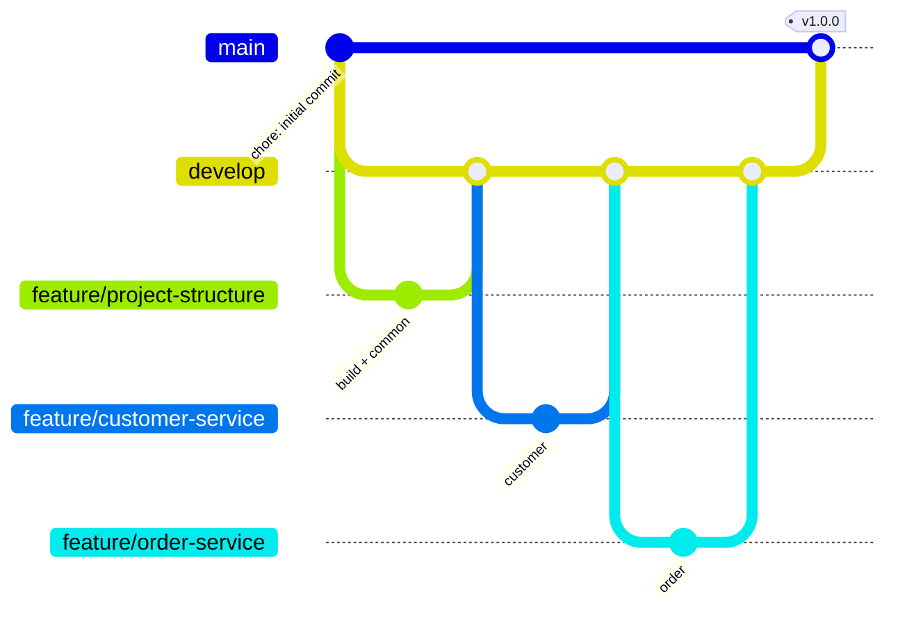

# Fluxo de Git e convenções

## Branches



| Branch | Papel |
|--------|-------|
| `main` | Código estável e publicado. Recebe merges só da `develop`. Cada release recebe uma tag (`v1.0.0`). |
| `develop` | Integração. Recebe as features validadas. |
| `feature/<nome>` | Uma etapa ou funcionalidade. Nasce da `develop` e volta para ela com `merge --no-ff`. |

Branches usadas no projeto: `feature/project-structure`, `feature/customer-service`, `feature/product-service`,
`feature/inventory-service`, `feature/order-service`, `feature/api-gateway`, `feature/docker` (inclui o banco),
`feature/ci-cd` e `feature/documentation`.

**Adaptação em relação ao plano inicial:** não foram criadas as branches `feature/unit-tests`,
`feature/integration-tests` e `feature/database` separadas. Os testes foram escritos **junto** com cada
funcionalidade (cada feature só foi integrada com testes verdes), e as migrations ficaram dentro de cada
serviço. Separar os testes em branches próprias permitiria integrar código sem testes, o que contraria a regra
"não fazer merge de funcionalidade sem testes".

## Commits: Conventional Commits

```
<tipo>(<escopo opcional>): <descrição no imperativo, em inglês>
```

| Tipo | Uso |
|------|-----|
| `feat` | Nova funcionalidade |
| `fix` | Correção de bug |
| `test` | Testes |
| `docs` | Documentação |
| `build` | Maven, Docker, dependências |
| `ci` | Pipeline |
| `refactor` | Mudança interna sem alterar comportamento |
| `chore` | Tarefas gerais |

Exemplos reais do histórico:

```
feat(inventory): implement stock control with idempotent reservations, commit and release
test(order): add domain, orchestration, http client and service communication tests
build: configure docker compose with health checks, networks and env variables
ci: configure github actions with build, tests, quality gates and docker smoke test
```

## Rotina para uma nova funcionalidade

```bash
git checkout develop
git pull
git checkout -b feature/minha-funcionalidade
# ... código + testes ...
./mvnw verify -DskipITs          # precisa passar antes de qualquer merge
git add -p
git commit -m "feat(order): add order cancellation reason"
git push -u origin feature/minha-funcionalidade
gh pr create --base develop      # o CI roda no Pull Request
```

## Release

```bash
git checkout main
git merge --no-ff develop -m "release: v1.1.0"
git tag -a v1.1.0 -m "v1.1.0"
git push origin main --tags
```
